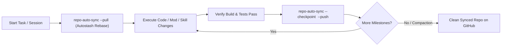

# Autonomous Git Repository Sync & Milestone Governor (`autonomous-git-repo-sync-governor`)

## When to Use
- **During Long Autonomous Sessions (`/goal`, `agy-yolo`, `claude-yolo`, `tandem-yolo`):** Automatically committing and pushing verified milestones so progress is never lost in uncommitted dirty worktrees.
- **General Development & Multi-Repo Workflows:** Keeping the active workspace and dependent repos (e.g., `cli-power-setup`, `ogsr-complete-merge`, `OGSR-Engine`, `zoneforge`, `rea`) synchronized with `origin` without manual git housekeeping.
- **Pre-Compaction & Session Handoff:** Ensuring all verified changes are committed and pushed (or safely checkpointed) before running `/compact`.

---

## 1. Closed-Loop Repo Synchronization Lifecycle

---

## 2. `repo-auto-sync` CLI Reference (`~/.local/bin/repo-auto-sync`)

| Command | Action |
| :--- | :--- |
| `repo-auto-sync --status [repo]` | Shows branch, ahead/behind remote counts, and dirty file tally. |
| `repo-auto-sync --pull [repo]` | Safely runs `git fetch` + `git pull --rebase --autostash` if behind `origin`. |
| `repo-auto-sync --checkpoint [repo] -m "feat: ..." --push` | Filters out `>50MB` binaries/temp files, stages verified changes, commits with conventional message, and pushes to `origin`. |
| `repo-auto-sync --fleet-status` | Scans all 30 repositories in `~/Documents/GitHub/` in parallel (`<0.5s`) showing branch, dirty count, and ahead/behind status. |
| `repo-auto-sync --fleet-pull` | Fast-forwards all clean repositories in `~/Documents/GitHub/` that have upstream updates waiting on GitHub. |

---

## 3. Mandatory Safety & Hygiene Guardrails
1. **Large Binary & Build Artifact Shield (`50 MB` Hard Cap):**
   - `repo-auto-sync --checkpoint` automatically unstages any accidental file `> 50 MB` (e.g., unpacked `.db`, `.pak`, `.utoc`, `.vpk`, core dumps, or raw `.blend1` backups) so GitHub's `100 MB` blob limit is never violated.
2. **Verify Before Pushing:**
   - Only run `--checkpoint --push` after syntax checks (`local-ast-compiler` / `luac -p` / `py_compile`) or build/test checks succeed. If mid-debug with broken code, use `working-memory-checkpointing` (`git stash` / local checkpoint branch) instead of pushing broken state to `main`.
3. **Detached HEAD Protection:**
   - If a repository is in `detached HEAD` state (e.g., `ogsr-complete-merge` root while worktrees `-argon` and `-fable` hold the active branches), `repo-auto-sync` warns and skips blind pushing so worktree branches remain authoritative.
