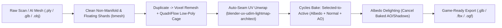

# 3D Gaussian Splatting, Photogrammetry & AI Scan Cleanup (`blender-gaussian-splatting-photogrammetry-cleanup`)

## When to Use
- Converting messy **3D Gaussian Splatting (`.ply`)**, photogrammetry scans (RealityCapture, Meshroom, Polycam), or AI-generated 3D meshes (Tripo3D, Hunyuan3D, Trellis) into clean, relightable game assets in headless Blender 5.2+ (`bpy`).
- Removing baked lighting/shadows ("delighting") from scanned albedo textures and baking high-res scan details onto clean low-poly UV topology.

---

## 1. End-to-End Scan / AI Mesh to Game-Ready PBR Pipeline



---

## 2. Automated Floating Shard Removal & Cage Retopology (`bpy`)
Raw photogrammetry and AI meshes often contain internal floating geometry pockets, non-manifold holes, and chaotic triangle soups:

```python
import bpy
import bmesh

def clean_and_retopologize_scan(scan_obj: bpy.types.Object, target_faces: int = 6000) -> bpy.types.Object:
    # 1. Duplicate scan to build the clean low-poly target cage
    low_obj = scan_obj.copy()
    low_obj.data = scan_obj.data.copy()
    low_obj.name = f"{scan_obj.name}_LowPoly"
    bpy.context.collection.objects.link(low_obj)

    bpy.context.view_layer.objects.active = low_obj
    # 2. Remove disconnected floating dust islands
    bm = bmesh.new()
    bm.from_mesh(low_obj.data)
    bmesh.ops.remove_doubles(bm, verts=bm.verts, dist=0.0005)
    bmesh.ops.recalc_face_normals(bm, faces=bm.faces)
    bm.to_mesh(low_obj.data)
    bm.free()

    # 3. Watertight Voxel Remesh -> QuadriFlow Retopology
    low_obj.data.remesh_voxel_size = 0.008
    bpy.ops.object.voxel_remesh()
    bpy.ops.object.quadriflow_remesh(
        use_mesh_symmetry=False,
        use_preserve_sharp=True,
        use_preserve_boundary=True,
        target_faces=target_faces
    )
    return low_obj
```

---

## 3. Albedo Texture Delighting (Removing Baked Scan Shadows)
Scanned and AI-generated textures have ambient crevice shadows baked directly into their base color, which looks wrong when dynamically lit in Unreal, Godot, or OGSR.
1. Bake both `EMIT` / `DIFFUSE` (color only) and `AO` (`Normalized`) from `scan_obj` onto `low_obj`.
2. Cancel baked crevice darkening in Python (`numpy`) by dividing out the soft low-frequency AO contribution while clamping highlights:
   ```python
   import numpy as np

   def delight_albedo(albedo_rgb: np.ndarray, baked_ao: np.ndarray, strength: float = 0.65) -> np.ndarray:
       """albedo_rgb: float32 [0..1] (H,W,3), baked_ao: float32 [0..1] (H,W,1)"""
       divisor = np.clip(baked_ao * strength + (1.0 - strength), 0.25, 1.0)
       delighted = np.clip(albedo_rgb / divisor, 0.0, 1.0)
       return delighted
   ```

## Windows 10/11 & Cross-Platform Parity (`windows-linux-cross-os-runtime-bridge`)
- Compatible with both Linux and Windows 10/11 (`install.ps1` / `.cmd` shims, `Path(tempfile.gettempdir())`, and native toolchain resolution).
