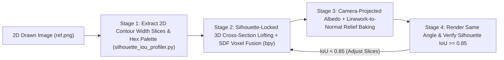

# 2D Drawn Image & Concept Art to High-Detail 3D Sculptor (`concept-art-sketch-to-3d-sculptor`)

## When to Use
- Turning a **single 2D drawn image, character illustration, concept sketch, or furry/creature refsheet** (e.g., `Aisha.png`) into an accurate, high-detail 3D model in Blender 5.2+ (`bpy`).
- Fixing proportion drift where a procedurally generated 3D model fails to match the silhouette, head-to-body ratio, or character likeness of the user's 2D artwork.

---

## 1. Why Naive 3D Modeling Fails on 2D Drawings (And How to Fix It)
Guessing sphere/cylinder sizes by eye from a 2D image always produces a generic "balloon-animal" approximation. Instead, follow this **4-Stage Mathematical & Visual Lock Pipeline**:



---

## 2. Stage 1: Extract Mathematical Slice Profiles & Color Swatches from the Drawing
Before opening Blender, run the bundled profiler script (`~/.gemini/config/skills/concept-art-sketch-to-3d-sculptor/scripts/silhouette_iou_profiler.py`) on the user's 2D reference image:
```bash
~/.gemini/config/skills/concept-art-sketch-to-3d-sculptor/scripts/silhouette_iou_profiler.py profile /path/to/drawing.png --slices 32 --json /tmp/drawing_profile.json
```
- **What it extracts automatically on local CPU/RAM:**
  - Exact bounding box aspect ratio (`height / width`).
  - Normalized left/right contour coordinates `(x_center, half_width)` at 32 vertical height slices $h \in [0.0, 1.0]$.
  - Top 8 dominant RGB/Hex color swatches from the drawing for shader palette matching.

---

## 3. Stage 2: Silhouette-Locked 3D Lofting & Visual Hull Carving (`bpy`)
1. Load `/tmp/drawing_profile.json` inside your headless Blender 5.2 script.
2. Drive cross-section widths along the vertical axis directly from the extracted `half_width` array instead of hardcoding arbitrary numbers.
3. Combine with **`autonomous-3d-reference-researcher`** for the missing depth ($Z$) ratio (e.g., feline chest depth $= 1.15 \times$ chest width; human ribcage depth $= 0.72 \times$ chest width).
4. Fuse all anatomical parts using **`blender-sdf-organic-remeshing`** (`voxel_remesh` + `LAPLACIANSMOOTH` with `use_volume_preserve=True`) and sculpt bony planes.

---

## 4. Stage 3: Converting 2D Linework & Shading into High-Detail 3D Relief
To transfer fine drawn details (fur strokes, facial markings, whiskers, clothing folds, scars) onto the 3D surface:
1. **Camera-Projected UVs (`PROJECT_FROM_VIEW`):** Align an orthographic camera to match the drawing's view angle, unwrap front-facing polygons via `bpy.ops.uv.project_from_view(camera_bounds=True, correct_aspect=True)`, and feather seam transitions across lateral faces.
2. **Luminance-to-Height / Normal Map Conversion:** Extract high-frequency luminance details from the 2D drawing (`high_pass = gray - gaussian_blur(gray, sigma=4.0)`) and convert horizontal/vertical Sobel gradients `(dX, dY)` into a **2048x2048 Tangent-Space Normal Map** (`_bump.dds` / `_norm.png`) + `MOD_DISPLACE` micro-relief on the high-poly sculpt before baking to the low-poly game mesh.

---

## 5. Stage 4: Closed-Loop Silhouette IoU Self-Correction
Render the 3D model with transparent background (`film_transparent = True`) from the reference camera angle and run the IoU comparator:
```bash
~/.gemini/config/skills/concept-art-sketch-to-3d-sculptor/scripts/silhouette_iou_profiler.py compare /path/to/drawing.png /tmp/render_front.png --diff-out /tmp/iou_overlay.png
```
- Inspect `/tmp/iou_overlay.png` (Green = matched overlap, Red = missing 3D volume, Blue = excess 3D volume) and adjust slice radii until **IoU $\ge 0.85$**.
