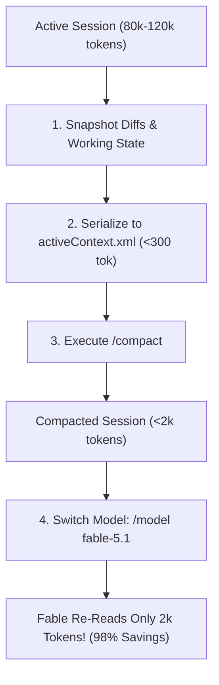

# Cross-Model Switch Pruner (`cross-model-switch-pruner`)

When switching models mid-session in Claude Code CLI (e.g. from Claude 3.7 Sonnet to Claude Fable 5.1 via `/model fable`), Anthropic's prompt cache cannot reuse the previous model's cache keys. As a result, **the entire conversation transcript is sent to the new model as 100% uncached input tokens**.

If a session has accumulated 80,000 to 150,000 tokens of command output, file reads, and diffs, that single switch turn bills the entire history at full input rates.

This skill eliminates history re-read overhead by enforcing **Pre-Switch Compaction** and **Zero-History Fresh Handoffs**.

---

## 1. Token Cost & Quota Impact Comparison

| Switching Method | Tokens Re-Read by Fable | Server-Side Cache Status | Cost / Quota Impact |
| :--- | :--- | :--- | :--- |
| **Unmanaged Mid-Session Switch** (`/model fable`) | **80,000 – 150,000 tokens** | 0% Cache Hit (Full re-read) | Expensive; burns substantial rolling 5h quota on dead tool logs |
| **In-Place Pre-Switch Compaction** (`/compact` $\rightarrow$ `/model fable`) | **~1,200 – 2,500 tokens** | Compacted summary only | **98% quota reduction** |
| **Zero-History Fresh Launch** (`stage handoff` $\rightarrow$ `claude -m fable`) | **< 300 tokens** | Fresh session; clean state | **99.7% quota reduction** |

---

## 2. Protocol A: In-Place Pre-Switch Compaction (Same Terminal)

Use this protocol when you wish to remain in the active Claude Code CLI session:



### Step-by-Step Procedure:
1. **Snapshot Working Diffs:**
   ```bash
   git diff > .agents/checkpoints/switch_$(date +%s).diff
   ```
2. **Serialize State via `model-optimal-state-serializer`:**
   Write the immediate blocker, active hypotheses, and next step to `.agents/memory/activeContext.xml` (or `.md`) in under 30 lines.
3. **Execute Compaction:**
   Run `/compact`. The entire verbose chat transcript is cleared, leaving only the condensed memory bank.
4. **Switch Model:**
   Execute `/model fable-5.1` (or select Fable via UI).
5. **Result:** Fable’s initial turn only ingests the 1,500-token summary, saving over 90,000 tokens on the switch.

---

## 3. Protocol B: Zero-History Fresh Handoff (Recommended for Fable)

Because Claude Fable features a 1-million-token context window designed for deep whole-codebase reasoning, launching Fable in a clean session is mathematically superior to carrying over old session noise:

1. **Stage Handoff Packet in Existing Session:**
   ```bash
   # Generates .agents/handoff.json using symbol coordinates (<file>#L<line>:<sig>)
   stage handoff
   ```
2. **Launch Dedicated Fable Session:**
   ```bash
   claude --model fable-5.1
   ```
3. **Instant Hydration:**
   Prompt Fable: `"Resume handoff"`. Fable reads `.agents/handoff.json` and `.agents/memory/activeContext.xml` in under 300 tokens.
4. **Result:** Zero old tool outputs re-read; 100% working state restored; full 1M context available for engine reasoning.

---

## 4. Integration with Existing Skills

- **`model-optimal-state-serializer` & `argon-sentencepiece-serializer`:** Formats pre-switch state into SentencePiece-optimal TSV/Markdown for Gemini 4 Argon (`activeContext.md`) or BPE-optimal XML tags (`<session-state>`) for Claude.
- **`dynamic-repo-model-cheatsheet` (`agy-cheatsheet` / `cs`):** Automatically detects when your active file modifications shift from config/UI (`Flash • Low`) to C++/shaders (`Argon • High`) and updates the bottom of your statusline (`🧭 CS [...]`) so you know when to compact and switch tiers.
- **`cross-cli-session-handoff`:** Manages the `.agents/handoff.json` contract for clean session detachment.
- **`fable-virtual-context-manager` & `argon-long-haul-context-compaction-gate`:** Pages subsystem slices and enforces compaction boundaries across 1M-token context windows.

## Windows 10/11 & Cross-Platform CLI Interop (`windows-linux-cross-os-runtime-bridge`)
- **Cross-OS Deployment (`install.ps1` & `install.sh`):** All state snapshotting, `repo-auto-sync --checkpoint`, and `agy-cheatsheet` (`cs`) commands run natively on Windows 10/11 and Linux.

## Related & Interoperating Skills
- **`cross-agent-context-deduplicator`**: Eliminates redundant transcript ingestion and context pollution between Argon orchestrators and Flash subagent...
- **`claude-context-rot-shield`**: Mitigates Claude context window degradation and prompt cache misses. Enforces 80k-token milestone compaction b...
- **`high-density-prompting`**: Compresses verbose prompts into surgical, quota-saving directives, eliminates speculative reasoning tokens, an...
- **`dynamic-repo-model-cheatsheet` (`agy-cheatsheet` / `cs`)**: Live statusline & repo model/effort router.
