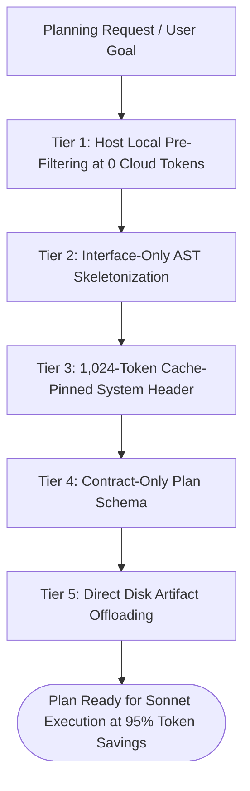

# Fable Planning Token Compressor (`fable-planning-token-compressor`)

Claude Fable's **1-million-token context** and **128,000-token output capacity** make it an unmatched architectural planner. However, unconstrained planning sessions frequently suffer from two severe token traps:
1. **Raw Code Ingestion Bloat:** Ingesting 200,000–500,000 tokens of full `.cpp` / `.py` files into Fable when planning only requires class interfaces and type definitions.
2. **Output Plan Essay Bloat:** Generating 8,000–20,000 output tokens of speculative implementation code directly into the chat transcript, permanently inflating all subsequent turns.

This skill enforces a **5-tier token compression pipeline** that slashes Fable planning costs by **up to 95%** while increasing architectural precision.

---

## ⚡ The 5-Tier Fable Planning Compression Pipeline



---

### Tier 1: Host Local Pre-Filtering (0 Cloud Tokens)
Before invoking Fable, never ask it to "find all files related to X":
- **Run Local AST / RAG:** Run `local-coprocessor exec --task code-repo --prompt "Find candidate files for X"` or `token-guard grep -n "symbol"`.
- **Payload Minimization:** Hand Fable the exact 5–10 candidate files rather than making Fable scan 300 files in the repository.

---

### Tier 2: Interface-Only AST Skeletonization
Planning requires knowing **what** classes and methods exist, not **how** their internals are implemented.
- **Rule:** Strip function bodies, private helpers, and inline boilerplate before ingestion:
  ```cpp
  // INGESTION STANDARD: Public signatures only (~40 tokens vs ~800 tokens)
  class CAI_Stalker : public CCustomMonster {
  public:
      virtual void Load(LPCSTR section) override;
      virtual void Think() override;
      virtual BOOL net_Spawn(CSE_Abstract* DC) override;
  };
  ```
- **Savings:** A 100,000-line subsystem shrinks from ~750,000 tokens to **$\le 15,000$ tokens**, fitting comfortably into Fable with zero lost-in-the-middle degradation.

---

### Tier 3: 1,024-Token Cache-Pinned System Header
Anchor Fable's planning session to Anthropic's **1,024-token prompt caching blocks**:
- Group coding standards, architecture diagrams, and tool definitions into a static immutable prefix.
- Prevents cache invalidation, ensuring input tokens are billed at **90% discount** (\$0.30/M vs \$3.00/M).

---

### Tier 4: Contract-Only Plan Schema (No Code in Plans)
Fable's plan must strictly define **contracts, dependencies, and verification gates**, leaving implementation to Sonnet:
```markdown
### Phase 1: Header Definitions (xrGame/weapon_ak74.h)
- Add: `virtual void InvalidateMuzzleFlash();`
- Target Lines: L45-L48
- Verification: `ninja -C build xrGame`

### Phase 2: Implementation (xrGame/weapon_ak74.cpp)
- Implement `InvalidateMuzzleFlash` adhering to 64-bit alignment.
- Verification: `pytest tests/test_weapon_ballistics.py`
```
- **Prohibited:** Writing full function bodies or multi-page code samples in the plan.
- **Output Token Savings:** Slashes Fable plan generation from 15,000 tokens down to **800–1,200 tokens**.

---

### Tier 5: Direct Disk Artifact Offloading
Never dump multi-thousand-word plans into the chat transcript.
- **Action:** Instruct Fable to write the plan directly to `.agents/plans/<subsystem_plan>.md` using `Write`.
- **Chat Response:** Output only a 3-line clickable summary:
  ```markdown
  [✓] Architectural Plan Created: [.agents/plans/subsystem_plan.md](file:///abs/path)
  - Scope: 4 phases, 7 target files, 0 breaking interface changes.
  - Next Step: Ready for Sonnet execution.
  ```
- **Savings:** Prevents chat transcript bloat, saving thousands of tokens from being re-billed across every single downstream implementation turn.

---

## 📊 Token Economics Comparison

| Planning Metric | Traditional Unconstrained Fable | Guarded Fable Planning Compressor | Savings |
| :--- | :--- | :--- | :--- |
| **Input Context** | 350,000 raw source tokens | 12,500 AST skeleton tokens | **-96.4%** |
| **Prompt Cache Hit Rate** | ~15% (volatile prefixes) | **95%+ (pinned static blocks)** | **+80% cache** |
| **Output Plan Tokens** | 12,000 tokens (essay + code blocks) | 950 tokens (contract schema to disk) | **-92.1%** |
| **Transcript Drag** | 12,000 tokens re-billed every turn | 120 tokens (3-line link summary) | **-99.0%** |
| **Estimated Plan Cost** | **~\$1.25 – \$2.10** | **~\$0.04 – \$0.08** | **~96% Cost Cut** |

## Windows 10/11 & Cross-Platform Parity (`windows-linux-cross-os-runtime-bridge`)
- Compatible with both Linux and Windows 10/11 (`install.ps1` / `.cmd` shims, `Path(tempfile.gettempdir())`, and native toolchain resolution).

## Related & Interoperating Skills
- **`fable-atomic-diff-sequencer`**: Multi-file refactor execution coordinator for Claude Fable 5.1. Regulates Fable's 128k output capacity by brea...
- **`fable-virtual-context-manager`**: Virtualized context paging and hierarchical indexing for Claude Fable (1M-token context). Prevents full 1M-tok...
- **`claude-fable-engine-governor`**: Autonomous context, token, and quota governor for Anthropic's Claude Fable model during large-scale game engin...
- **`dynamic-repo-model-cheatsheet` (`agy-cheatsheet` / `cs`)**: Live statusline & repo model/effort router.
