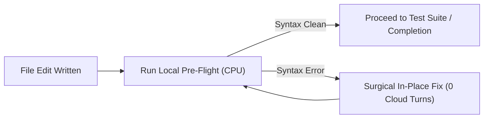

# Local Pre-Flight Syntax Gate (`local-preflight-syntax-gate`)

The most expensive failure mode for frontier models (Claude Opus, Gemini Argon, OpenAI o1/o3) is submitting a mechanical syntax error (missing semicolon, mismatched parentheses, bad indent), receiving an error in the next turn, and spending 5,000–15,000 internal thinking tokens diagnosing a trivial typo.

This skill interposes an ultra-fast (15ms–100ms) local host CPU pre-flight gate that validates syntax **before** handing control back to the model or triggering cloud builds.

---

## 1. Native Pre-Flight Linter Matrix

| Language | Local Verification Command | Host Latency | Cloud Token Savings |
| :--- | :--- | :--- | :--- |
| **Lua / LuaJIT** | `luac -p <file.lua>` | ~5ms | 10k–25k thinking tokens |
| **Python** | `python3 -m py_compile <file.py>` or `ruff check --select E,F` | ~20ms | 12k–30k thinking tokens |
| **Rust** | `cargo check --quiet --message-format=short` | ~150ms | 20k–50k thinking tokens |
| **C / C++** | `clang-format --dry-run --Werror <file>` or `clang++ -fsyntax-only` | ~50ms | 15k–40k thinking tokens |
| **TypeScript / JS** | `npx tsc --noEmit --pretty false` | ~300ms | 15k–35k thinking tokens |
| **Shell / Bash** | `bash -n <script.sh>` and `shellcheck -S error` | ~10ms | 8k–20k thinking tokens |
| **JSON / YAML** | `python3 -c "import json; json.load(open('file'))"` | ~10ms | 8k–15k thinking tokens |

---

## 2. Gate Execution Protocol

Whenever code is created or modified via `replace_file_content` or `write_to_file`:

1. **Host-First Verification:**
   - Execute the appropriate syntax command (`bash -n`, `luac -p`, `py_compile`) via `run_command` immediately after modifying code.
2. **Short Output Filtering:**
   - Never print passing output. If exit code is 0, report only `[✓] Syntax verified (0 errors)`.
3. **Immediate Typo Repair:**
   - If a line error is reported locally (e.g. `luac: script.lua:42: 'then' expected near '='`), fix the single line immediately without speculative reasoning.

---

## 3. Integration with Autonomous Runners

- **`yolo-autonomous-watchdog`:** Enforces pre-flight syntax gates before triggering lengthy game builds or Wine/Proton tests.
- **`self-healing-test-automation`:** Checks locator script syntax locally before spawning headless browser instances.
- **`stalker-luajit-ffi-migration`:** Runs `luac -p` on every ported script to catch 64-bit Lua syntax incompatibilities instantly.

## Windows 10/11 & Cross-OS Hardware Offload Parity (`windows-linux-cross-os-runtime-bridge`)
- **CPU Thread Saturation:** Use `os.cpu_count()` in Python, `$env:NUMBER_OF_PROCESSORS` in PowerShell 7 (`CMAKE_BUILD_PARALLEL_LEVEL=$env:NUMBER_OF_PROCESSORS`, `CARGO_BUILD_JOBS=$env:NUMBER_OF_PROCESSORS`, `msbuild /m`), and `$(nproc)` on Linux.
- **RAM-Disk & Scratch I/O:** Resolve scratch paths via `Path("/dev/shm")` on Linux, an ImDisk/OSFMount RAMDrive (`R:\`) if mounted on Windows, or `Path(tempfile.gettempdir())` (`%LOCALAPPDATA%\Temp`). Never hardcode `/tmp/`.
- **Dual-GPU Selection (RTX 5060 dGPU + Radeon 610M iGPU):** On Windows 10/11, bind executables via Registry `HKCU:\Software\Microsoft\DirectX\UserGpuPreferences` (`GpuPreference=1;` for Power-Saving AMD Radeon iGPU; `GpuPreference=2;` for High-Performance NVIDIA RTX 5060 dGPU) and `CUDA_VISIBLE_DEVICES=0`.
- **Vision & OCR on Windows:** Use `PIL.ImageGrab.grab(all_screens=True)` and resolve `tesseract.exe` via `shutil.which("tesseract")` or `C:\Program Files\Tesseract-OCR\tesseract.exe`.
